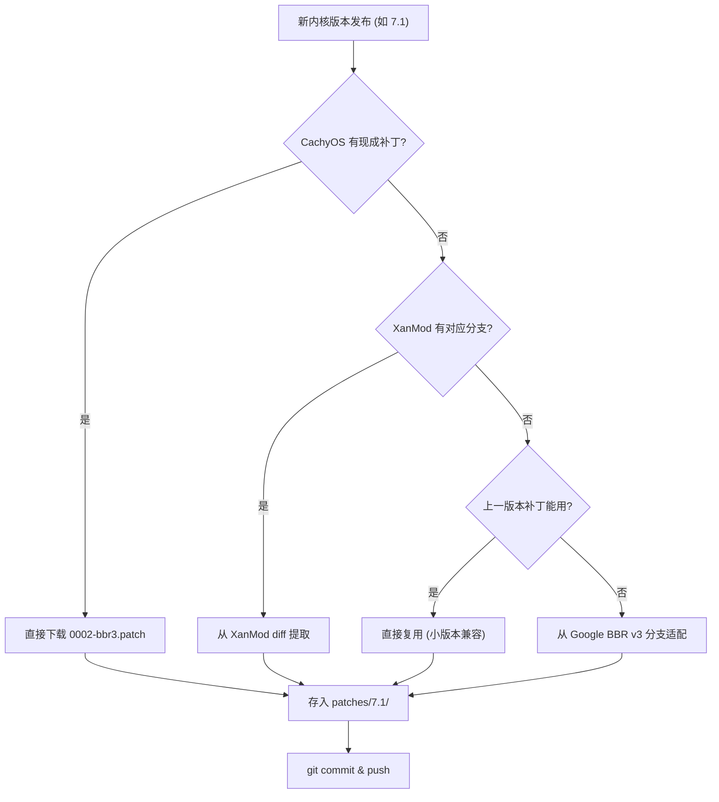

# BBRv3 补丁维护指南

## 补丁来源优先级



## 快速操作

### 自动提取（推荐）

```bash
# 在 Linux 环境（如 VPS）上运行
cd /path/to/Actions-bbr-v3
chmod +x patches/extract-bbr3.sh
./patches/extract-bbr3.sh 7.1
```

脚本会自动按优先级依次尝试所有来源。

---

### 手动操作：来源 1 — CachyOS（最简单）

```bash
# 检查 CachyOS 是否有对应版本
KERNEL=7.1
curl -sfL --head "https://raw.githubusercontent.com/CachyOS/kernel-patches/master/${KERNEL}/0002-bbr3.patch"

# 如果返回 200，直接下载
curl -fL "https://raw.githubusercontent.com/CachyOS/kernel-patches/master/${KERNEL}/0002-bbr3.patch" \
  -o patches/${KERNEL}/0002-bbr3.patch
```

如果 master 分支没有，搜索历史 commit：
```bash
# 查看最近的 commit 中是否有该版本
curl -s "https://api.github.com/repos/CachyOS/kernel-patches/commits?path=${KERNEL}&per_page=5" | \
  jq '.[].sha'

# 用找到的 sha 下载
SHA=xxxxx
curl -fL "https://raw.githubusercontent.com/CachyOS/kernel-patches/${SHA}/${KERNEL}/0002-bbr3.patch" \
  -o patches/${KERNEL}/0002-bbr3.patch
```

---

### 手动操作：来源 2 — XanMod diff

XanMod 将 BBRv3 直接整合到源码树。通过对比 XanMod 和 vanilla 内核的 diff 提取补丁：

```bash
KERNEL=7.1

# 1. 浅克隆 XanMod 和 vanilla（只取网络代码）
git clone --depth=1 -b ${KERNEL} --sparse https://gitlab.com/xanmod/linux.git /tmp/xanmod
cd /tmp/xanmod && git sparse-checkout set net/ipv4 include/net include/uapi/linux

git clone --depth=1 -b v${KERNEL} --sparse https://github.com/torvalds/linux.git /tmp/vanilla
cd /tmp/vanilla && git sparse-checkout set net/ipv4 include/net include/uapi/linux

# 2. 生成 diff（仅 BBRv3 相关文件）
diff -ruN /tmp/vanilla/net/ipv4/tcp_bbr.c /tmp/xanmod/net/ipv4/tcp_bbr.c > /tmp/bbr3.patch
diff -ruN /tmp/vanilla/net/ipv4/tcp_input.c /tmp/xanmod/net/ipv4/tcp_input.c >> /tmp/bbr3.patch
diff -ruN /tmp/vanilla/net/ipv4/tcp_output.c /tmp/xanmod/net/ipv4/tcp_output.c >> /tmp/bbr3.patch
diff -ruN /tmp/vanilla/net/ipv4/tcp_rate.c /tmp/xanmod/net/ipv4/tcp_rate.c >> /tmp/bbr3.patch
diff -ruN /tmp/vanilla/include/net/tcp.h /tmp/xanmod/include/net/tcp.h >> /tmp/bbr3.patch
diff -ruN /tmp/vanilla/include/uapi/linux/inet_diag.h /tmp/xanmod/include/uapi/linux/inet_diag.h >> /tmp/bbr3.patch

# 3. 修正路径格式（diff -ruN 输出需要调整）
sed -i 's|/tmp/vanilla/|a/|g; s|/tmp/xanmod/|b/|g' /tmp/bbr3.patch

# 4. 验证
grep -c 'BBR_VERSION' /tmp/bbr3.patch   # 应能搜到

# 5. 复制到项目
cp /tmp/bbr3.patch patches/${KERNEL}/0002-bbr3.patch
```

> ⚠️ XanMod diff 可能包含非 BBRv3 的改动（如其他网络优化）。
> 建议对比 CachyOS 版本的补丁，确认文件范围一致。

---

### 手动操作：来源 3 — 复用上一版本

BBRv3 补丁在 **同一大版本** 的内核间通常兼容：

```bash
# 例如 7.0 → 7.1（同大版本，高概率兼容）
cp patches/7.0/0002-bbr3.patch patches/7.1/0002-bbr3.patch

# 验证（需要内核源码）
cd /path/to/linux-7.1-source
patch --dry-run -p1 < /path/to/patches/7.1/0002-bbr3.patch
# 如果显示 "patching file..." 无错误，说明兼容
```

**跨大版本**（如 6.19 → 7.0）通常不兼容，不建议直接复用。

---

### 手动操作：来源 4 — Google BBR 官方

```bash
# Google BBR v3 分支（基于较旧内核，通常需要适配）
git clone --depth=50 -b v3 https://github.com/google/bbr.git /tmp/google-bbr
cd /tmp/google-bbr

# 查看 BBRv3 相关 commit
git log --oneline -- net/ipv4/tcp_bbr.c

# 查看基线
git log --oneline | tail -5

# 提取 diff（需知道基线 tag）
git diff <baseline_tag>..HEAD -- \
  net/ipv4/tcp_bbr.c \
  net/ipv4/tcp_input.c \
  net/ipv4/tcp_output.c \
  net/ipv4/tcp_rate.c \
  include/net/tcp.h \
  include/uapi/linux/inet_diag.h \
  > /tmp/bbr3-google.patch
```

> ⚠️ Google BBR v3 分支基于较旧内核（~6.8），
> 提取的补丁几乎一定需要手动解决冲突。
> 仅在其他来源全部不可用时使用。

---

## BBRv3 涉及的核心文件

| 文件 | 作用 |
|---|---|
| `net/ipv4/tcp_bbr.c` | BBRv3 主体（拥塞控制算法） |
| `net/ipv4/tcp_input.c` | TCP 输入处理（ECN、ACK 处理） |
| `net/ipv4/tcp_output.c` | TCP 输出处理（pacing、TLP） |
| `net/ipv4/tcp_rate.c` | 速率采样（rate sampling） |
| `net/ipv4/tcp_minisocks.c` | 连接状态管理 |
| `net/ipv4/bpf_tcp_ca.c` | BPF 拥塞控制接口 |
| `include/net/tcp.h` | TCP 内部头文件（结构体扩展） |
| `include/uapi/linux/inet_diag.h` | 用户态诊断接口（ss 工具显示） |

## 验证补丁正确性

```bash
# 1. 检查 BBR_VERSION 3 定义
grep -P 'BBR_VERSION\s+3' patches/<version>/0002-bbr3.patch

# 2. 检查 BBRv3 独有符号
grep 'bbr_ecn_alpha' patches/<version>/0002-bbr3.patch
grep 'bbr_loss_thresh' patches/<version>/0002-bbr3.patch

# 3. 检查作者列表（应包含 BBRv3 团队）
grep 'David Morley\|Kevin Yang\|Arjun Roy' patches/<version>/0002-bbr3.patch

# 4. dry-run 测试（需要目标内核源码）
cd /path/to/linux-<version>
patch --dry-run -p1 < patches/<version>/0002-bbr3.patch
```
